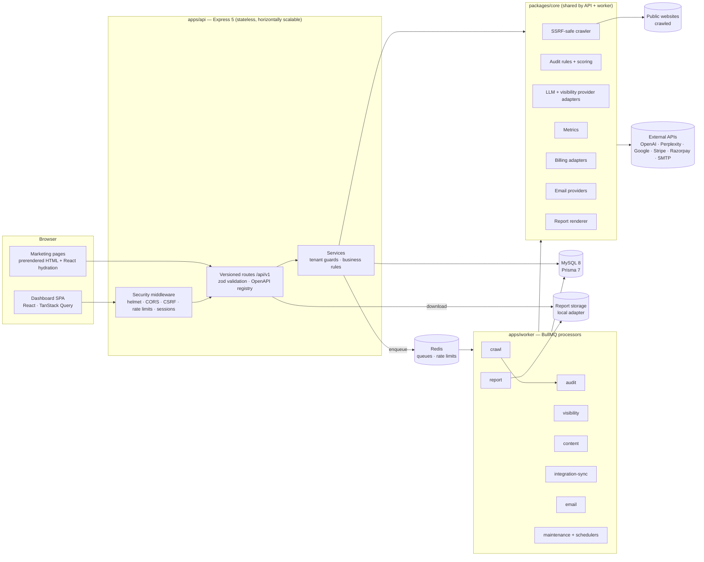
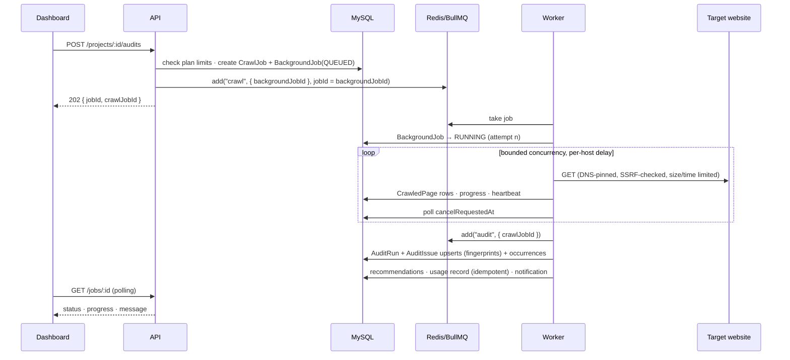
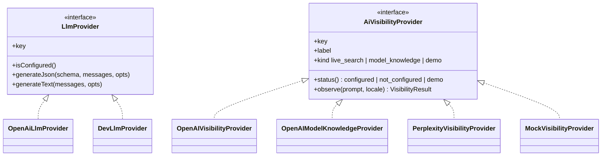

# Architecture

## 1. System overview



Key properties:

- **API and worker are separate processes.** The API never runs long jobs inline. It writes a `BackgroundJob`
  row, enqueues a BullMQ job with the same id, and returns `202 Accepted` with the job id.
- **`packages/core` holds the domain logic** (crawler, rules, providers, metrics, billing, email, reports), so the
  API and worker share one implementation. `packages/shared` is isomorphic: zod schemas, enums, plan config,
  permissions, metric formulas and the audit rule catalog, all used by the browser and the server.
- **MySQL is the source of truth.** Redis holds only queue state and rate-limit counters, so losing Redis never
  loses customer data. Job status is persisted in `background_job_records`.

## 2. Repository layout

```
apps/
  api/        Express app factory (src/app.ts), routes, services, middleware, OpenAPI, Supertest tests
  worker/     BullMQ workers, processors, job schedulers, maintenance
  web/        Vite + React 19 app: marketing pages (prerendered) + dashboard SPA, RTL tests
packages/
  shared/     zod request schemas, DTO types, enums, plans, permissions, metric formulas, rule catalog
  core/       env, logger, prisma client, queues, crawler, audit, ai, content, billing, email, reports, integrations
prisma/       schema.prisma, migrations/, seed.ts
e2e/          Playwright specs + a local fixture website used as a crawl target
docs/         architecture, database, API, security, setup, deployment, decisions, progress, test report
scripts/      developer utilities (reference capture, local Redis helper)
```

## 3. Request lifecycle (API)

1. `requestId` assigns or propagates `X-Request-Id`, and `pino-http` logs with secrets redacted.
2. `helmet` sets the security headers, and `cors` applies the strict origin allowlist with credentials.
3. Body parsers have size limits (`1mb` JSON). Webhook routes receive the **raw** body for signature checks.
4. `session` reads the HTTP-only `sf_session` cookie, looks up the SHA-256 token hash and loads the user.
   Disabled or expired sessions are rejected.
5. `csrf` applies to state-changing methods: a signed double-submit token (`sf_csrf` cookie plus the
   `X-CSRF-Token` header) and an `Origin` check. Webhooks and OAuth callbacks are exempt and have their own verification.
6. Route-level zod validation of `params`, `query` and `body`, then authorization:
   - `requireAuth`, `requirePlatformAdmin`
   - `loadProject(permission)`: fetches the project **and** confirms the caller's membership role in its
     workspace. Any other workspace's project returns **404**, so ids cannot be probed.
7. Services run the business logic (Prisma transactions where several writes must succeed together).
8. Response formats:
   - Success: `{ "data": ..., "meta"?: { "page", "pageSize", "total", "totalPages" } }`
   - Error: `{ "error": { "code", "message", "details"?, "requestId" } }` with meaningful HTTP status codes
     (400, 401, 402 plan limit, 403, 404, 409, 413, 422, 429, 500, 503).

## 4. Background jobs



| Queue              | Processor                                                                                                                                                                                                       | Concurrency                                    | Retries              | Notes                                                                                                                   |
| ------------------ | --------------------------------------------------------------------------------------------------------------------------------------------------------------------------------------------------------------- | ---------------------------------------------- | -------------------- | ----------------------------------------------------------------------------------------------------------------------- |
| `crawl`            | crawl website                                                                                                                                                                                                   | 2                                              | 2                    | A retry deletes the partial pages of the same crawl, then restarts                                                      |
| `audit`            | rule engine + scoring                                                                                                                                                                                           | 2                                              | 3                    | Idempotent upserts by fingerprint                                                                                       |
| `visibility`       | provider calls                                                                                                                                                                                                  | 2 runs (3 parallel calls each), limiter 30/min | 3 (exponential)      | One observation per (run, prompt, provider), with a unique idempotency key                                              |
| `content`          | LLM generation, keyword ideas                                                                                                                                                                                   | 2, limiter 20/min                              | 2                    | A version is keyed by `generationJobId`                                                                                 |
| `competitor`       | competitor public metadata and gap analyses                                                                                                                                                                     | 2                                              | 2                    | Same safe fetcher, small page budget                                                                                    |
| `trends`           | keyword trends reports (provider fetch, site comparison, AI placements)                                                                                                                                         | 2, limiter 10/min                              | 2                    | Rate limits and refusals are not retried; cached and imported data skip the fetch                                       |
| `local`            | local rank grid scans (licensed provider, one point at a time)                                                                                                                                                  | 2, limiter 20/min                              | 2 attempts per point | Points still failing are recorded and left out of the summary; quota is reserved per planned point when the scan starts |
| `report`           | HTML + PDF                                                                                                                                                                                                      | 1                                              | 2                    | Files are overwritten deterministically                                                                                 |
| `integration-sync` | Search Console; Business Profile (profile, metrics, reviews of linked locations); Merchant Center (account, products)                                                                                           | 2                                              | 3                    | Upserts by unique key                                                                                                   |
| `email`            | send/log email                                                                                                                                                                                                  | 5                                              | 5                    | Delivery status is recorded                                                                                             |
| `maintenance`      | stuck jobs (5 min), cleanup (hourly), scheduled audits and AI checks (15 min), scheduled trends refreshes (hourly), Search Console sync (03:30), account deletions (04:00), weekly summary (Mon 08:00), all UTC | 1                                              | 1                    | Job Schedulers (`upsertJobScheduler`); due items are claimed before work starts (D-020)                                 |

- **Cancellation:** `POST /jobs/:id/cancel` sets `cancelRequestedAt` and removes waiting jobs from BullMQ.
  Running processors check the flag between units of work and finish with status `CANCELLED`.
- **Stuck jobs:** BullMQ's stalled-job detection re-queues jobs whose worker died. The maintenance task also
  marks a `RUNNING` record whose heartbeat is older than its timeout and whose BullMQ job is no longer active
  as `FAILED`, with a clear message.
- **Rate limits and backoff:** queue limiters cap provider throughput. Adapters retry 429 and 5xx responses
  with exponential backoff and jitter, honouring `Retry-After`.

## 5. Crawler and SSRF defences

`packages/core/src/crawler`:

- `ssrf.ts` classifies IPv4/IPv6 addresses: it blocks loopback, private, CGNAT, link-local (including
  `169.254.169.254` metadata), multicast, reserved, documentation, benchmarking, NAT64/6to4-mapped private
  ranges, and unspecified addresses.
- `fetcher.ts` uses an **undici Agent with a custom `lookup`**. DNS is resolved once, every address is checked,
  and the socket connects to the validated address, so DNS rebinding between check and connect is not possible.
  Redirects are followed manually: every hop is re-parsed, re-validated (protocol `http(s)` only, ports 80/443
  plus an explicit dev allowlist) and counted (max 5). Response bodies are streamed with a byte cap and per-request timeouts.
- `robots.ts` (robots-parser) is fetched first. Disallowed URLs are skipped and recorded, `Crawl-delay` is
  honoured (capped), and `Sitemap:` lines are followed.
- `sitemap.ts` handles urlsets, sitemap indexes and gzip, with URL and nesting caps.
- `crawler.ts` runs a breadth-first frontier (a constant-time FIFO queue) with a same-site scope (optional
  subdomains), per-host politeness delay and bounded concurrency. It also checks cancellation. Page and depth caps
  are optional (`null` crawls every reachable page). Loop protection follows at most 100 query-string variants
  of one path and skips URLs longer than 2,048 characters; skipped links are counted (`loopUrlsSkipped`).
- The audit loads a stored crawl in batches (pages by id, links by primary key) and shares one link object
  per distinct target URL. Duplicate checks cover every indexable page: exact duplicates by grouping, near-duplicate
  titles by prefix-filtered Jaccard matching (PPJoin), near-duplicate content by six-block SimHash keys. Both
  give the same results as comparing every pair, and both have a comparison budget, recorded as a limitation if
  it is reached.
- `extract.ts` uses cheerio to pull the title, meta, canonical, robots, headings, links, images, JSON-LD, language,
  viewport, Open Graph data, word count, simhash and AEO signals (question headings, FAQ content).

The crawler never sends credentials or cookies and does not follow links behind login forms. It honours `noindex`
and `nofollow` as audit observations but still respects robots.txt for fetching.

## 6. AI provider architecture



- **OpenAI web search** (`openai_web_search`) calls the Responses API with the `web_search` tool and an
  approximate user location. Inline `url_citation` annotations and consulted sources become citations.
- **OpenAI model knowledge** (`openai_model_knowledge`) is a plain model answer with no browsing. It is
  labeled **"not a live search result"**.
- **Perplexity Sonar** (`perplexity_sonar`) calls the official Chat Completions API, which returns citations
  and search results. It is only active when `PERPLEXITY_API_KEY` is set.
- **Mock** (`mock_demo`) returns deterministic fixtures, flagged `isDemo=true`. It is enabled only when
  `AI_DEMO_MODE=true`, and every observation it produces is labeled "Demo data — not a real AI response".
- Mention matching is deterministic first: brand names and aliases on word boundaries, plus owned and
  competitor domains in text and citations. When a real LLM is configured, an AI-assisted check confirms
  name and alias matches (domain matches are always kept) and estimates sentiment. It never runs for demo data
  or the development adapter, and the deterministic matches stand if it fails.
- Sentiment is an **AI-derived estimate** (`sentimentSource = AI_ESTIMATE`) and is shown with that label.
- **Competitor gap analysis** (`core/competitors/gap.ts`, a job on the `competitor` queue) explains why answers
  recommend other brands. It finds every brand named, including untracked ones: stored matches, cited websites
  named in the text, and AI extraction verified word for word. It also finds the reasons given (each with a verified
  quote), classifies and live-checks cited pages with the safe fetcher, matches questions to crawled pages, and
  checks robots.txt for AI crawlers and the homepage without JavaScript. It then builds a rule-based action plan.
  Actions can be saved as recommendations. See D-036 and [metrics.md](metrics.md#competitor-gap-analysis).

- **Keyword trends** (`core/trends`, a job on the `trends` queue) takes Google Trends data from exactly one source
  per report through a provider registry (CSV, the optional pytrends service in `services/pytrends`, DataForSEO,
  a labeled fixture; the official alpha API is not implemented), stores it in normalized tables with source,
  retrieval time and limitations, reuses identical unexpired data, and compares it with the latest crawl and the
  project's Search Console queries. Saved comparisons refresh on a schedule. See D-039 and
  [providers/keyword-trends.md](providers/keyword-trends.md).

- **Local SEO** (`core/local`): business locations, rank grids (a job on the `local` queue; points from a licensed
  provider, manual observations or a labeled fixture), local competitors and the Local Search & AI Visibility
  dashboard, where each surface is its own card with source, freshness and limitations. See D-040.
- **Google Business Profile** (`core/local/business-profile.ts`, synced on the `integration-sync` queue): linked
  profiles, daily metrics and reviews, stored at most 30 days (purged by the hourly cleanup); profile audit; review
  replies published only after an approval for the exact text. See D-041 and
  [providers/google-business-profile.md](providers/google-business-profile.md).

- **Merchant Center and product feeds** (`core/commerce`): feed files (Google CSV/TSV, Shopify exports) and the
  read-only Merchant API sync (on the `integration-sync` queue) fill `merchant_products`; each product carries
  Surfaced's country- and program-aware checks and Google's item issues, and the eligibility checklist covers
  businesses without a website. See D-042.

- **SEO comparison** (`core/competitors/seo-compare.ts`, a job on the `competitor` queue) crawls the project and up
  to five competitors with the same page budget and time limit, runs the audit rule engine on each sample in memory,
  computes the checks in `SEO_METRICS`, compares your values with the competitors' median, and builds a prioritized
  suggestion list. Only the summary is stored (`seo_comparisons`). See D-037.

## 7. Frontend architecture

- **Vite 8 + React 19 + React Router 8** (declarative mode). Marketing pages are imported eagerly, and the
  dashboard pages are lazy-loaded chunks.
- **Prerendering:** `apps/web/scripts/prerender.ts` renders each public route with `StaticRouter` and
  `renderToString` into `dist/<route>/index.html`, with per-route `<title>`, description, canonical, Open Graph
  and JSON-LD. It also writes `dist/app.html` (the SPA shell, `noindex`), `sitemap.xml` and `robots.txt`.
  The client hydrates prerendered pages and mounts fresh on SPA routes.
- **State:** TanStack Query handles server state (keys per resource, polling while jobs run). React Hook Form
  and zod (the same schemas as the API) handle forms.
- **Design system:** Tailwind CSS 4 tokens (`@theme`) and shadcn-style primitives built on Radix UI, with
  Lucide icons and Recharts charts. The marketing theme is dark navy; the dashboard theme is light neutral.
- **API client:** `fetch` with `credentials: 'include'`, an automatic CSRF header, typed `ApiError`, and a
  redirect to login on 401.

## 8. Security boundaries (summary)

- Secrets exist only in server environment variables. The browser bundle receives `VITE_*` values only (API base
  URL and site URL).
- Tenant isolation is enforced in services and repositories by workspace-scoped queries and is covered by tests.
- OAuth tokens are encrypted with AES-256-GCM (`ENCRYPTION_KEY`). Session, reset, verification and invitation
  tokens are stored only as SHA-256 hashes.
- See [`security.md`](security.md) for the full checklist.

## 9. Deployment topology

The web app is static files (CDN or the API's static server). The API runs N stateless replicas behind a TLS proxy.
The worker runs M replicas, scaled independently. MySQL and Redis are managed services, and report files go to a
persistent volume (or object storage via the storage interface). See [`deployment.md`](deployment.md).
