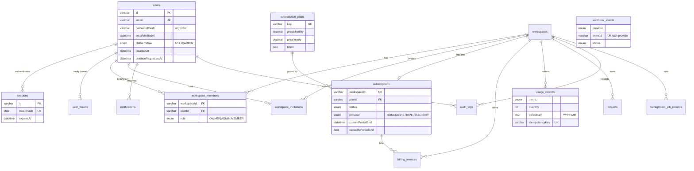
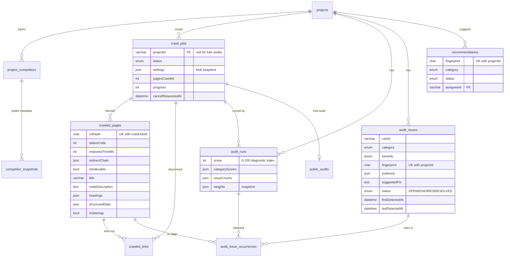
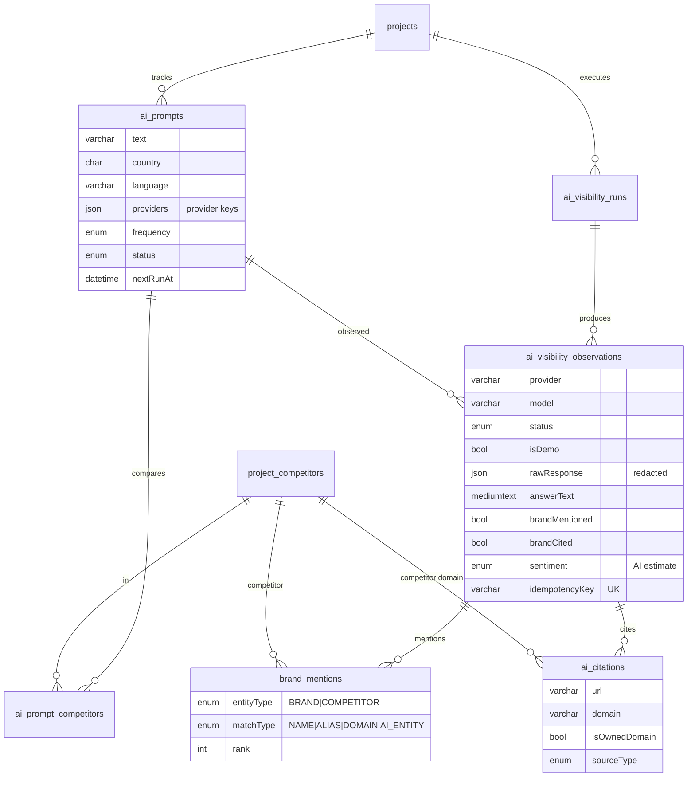
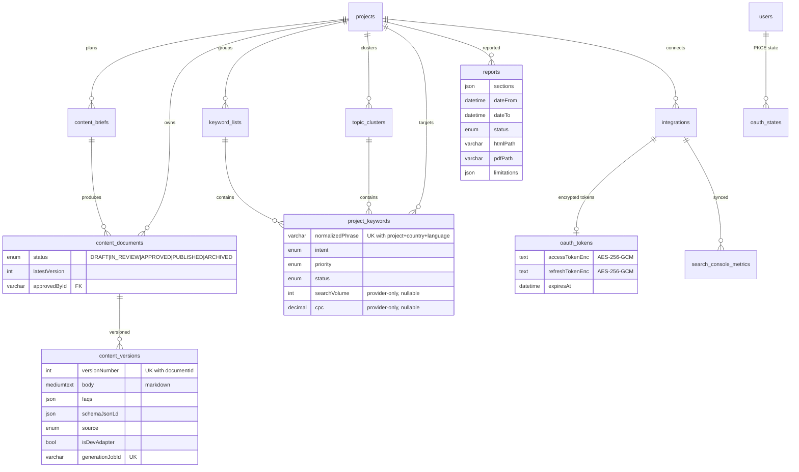

# Database design (MySQL 8 · Prisma 7)

The source of truth is [`prisma/schema.prisma`](../prisma/schema.prisma), and migrations live in `prisma/migrations/`.
The diagrams below are split by domain so they stay readable. Every tenant-owned table is reachable from
`workspaces` through foreign keys, and API services always scope queries by the caller's workspace memberships.

## Conventions

| Topic        | Rule                                                                                                                                                                                                   |
| ------------ | ------------------------------------------------------------------------------------------------------------------------------------------------------------------------------------------------------ |
| Primary keys | `VARCHAR(32)` CUIDs (non-sequential). Join tables use composite keys.                                                                                                                                  |
| Time         | `DATETIME(3)`, written in UTC by Prisma. Search Console days use `DATE`.                                                                                                                               |
| Money        | `DECIMAL(10,2)` (`subscription_plans`, `billing_invoices`, keyword CPC).                                                                                                                               |
| Long URLs    | `VARCHAR(2048)`, plus a `CHAR(64)` SHA-256 hash column for unique/indexed lookups (InnoDB cannot index 2048 utf8mb4 chars).                                                                            |
| JSON         | Only for small, schema-validated structures: settings snapshots, evidence, code lists (countries, languages, provider keys), plan limits. Never for relational data.                                   |
| Deletion     | `ON DELETE CASCADE` from workspace → project → everything below it. User references on content (author, assignee, approver) use `SET NULL`. Plans use `RESTRICT`.                                      |
| Idempotency  | `ai_visibility_observations.idempotencyKey`, `usage_records.idempotencyKey`, `content_versions.generationJobId`, `webhook_events (provider,eventId)`, `billing_invoices (provider,providerInvoiceId)`. |
| Secrets      | Session/verification/reset/invitation/OAuth-state tokens are stored only as SHA-256 hashes. OAuth access and refresh tokens and PKCE verifiers are AES-256-GCM ciphertext.                             |
| Demo data    | `projects.isDemo`, `crawl_jobs.isDemo`, `audit_runs.isDemo`, `ai_visibility_runs.isDemo` and `ai_visibility_observations.isDemo` flag records created by the dev seed or mock provider.                |

## Identity, tenancy, billing

## Projects, crawling and audits

## AI visibility (AEO/GEO)

## Content, keywords, reports, integrations

## Table summary

| Table                                                                                        | Purpose                                                                                                                                                                                                                                                                                  |
| -------------------------------------------------------------------------------------------- | ---------------------------------------------------------------------------------------------------------------------------------------------------------------------------------------------------------------------------------------------------------------------------------------- |
| `users`, `sessions`, `user_tokens`                                                           | Accounts, server-side sessions, email-verification and password-reset tokens                                                                                                                                                                                                             |
| `workspaces`, `workspace_members`, `workspace_invitations`                                   | Tenancy and roles                                                                                                                                                                                                                                                                        |
| `projects`, `project_competitors`, `competitor_snapshots`                                    | Websites under management, competitors, public competitor metadata                                                                                                                                                                                                                       |
| `visibility_gap_analyses`                                                                    | Competitor gap analyses: status and the stored report (brands, reasons, sources, live checks, actions)                                                                                                                                                                                   |
| `seo_comparisons`                                                                            | SEO comparisons: chosen competitors, status and the stored result (per-site summaries, checks and suggestions; no per-page rows)                                                                                                                                                         |
| `trend_reports`                                                                              | Keyword trends comparisons: one source each (pytrends, DataForSEO, CSV import, fixture), terms, place, period, data types, cache key, partial flag, limitations, retrieval/expiry, comparison with the site                                                                              |
| `trend_observations`, `trend_regional_interest`, `trend_related_items`                       | Normalized Google Trends data of a report: interest over time per term and period, interest by place, related queries and topics (relative values, never counts)                                                                                                                         |
| `trend_csv_imports`, `trend_saved_queries`                                                   | Imported Google Trends files (kind, terms, rows); saved comparisons with a weekly or monthly refresh schedule                                                                                                                                                                            |
| `trend_provider_events`                                                                      | Outcome of each trends provider request (success, cache hit, rate limit, timeout…), kept 90 days for provider status                                                                                                                                                                     |
| `business_locations`                                                                         | Business locations (storefront, service area or both): address, coordinates, categories, hours, phone; optional link to a Business Profile location (`profileLocationName`, `profileAccountName`) and Google place ID. Archived, never deleted. Counts against the plan's location limit |
| `local_rank_queries`, `local_rank_scans`, `local_rank_points`                                | Local rank grids: a query tracked around a location (surface, grid size, spacing, depth, schedule), each scan with its source (licensed provider, manual, fixture) and summary, and one row per grid point with the businesses listed there                                              |
| `business_profile_snapshots`, `business_profile_metrics`, `business_reviews`                 | Google Business Profile data of linked locations: the profile as returned, daily performance values and recent reviews. Replaced at each sync and **deleted after 30 days** (Google's storage limit); also deleted on unlink, archive and disconnect                                     |
| `merchant_products`, `product_feed_imports`                                                  | Products from imported feed files or the connected Merchant Center account (attributes as given, Surfaced's checks and Google's item issues, Google's destination statuses), unique per project, source, country, language and id; and one row per imported file                         |
| `review_replies`                                                                             | Reply drafts (written or AI-drafted), their status (draft, awaiting approval, publishing, published, failed, discarded) and publish result; publishing needs an approved `approval_requests` row for the exact text                                                                      |
| `crawl_jobs`, `crawled_pages`, `crawled_links`                                               | Crawl executions and their page and link data                                                                                                                                                                                                                                            |
| `audit_runs`, `audit_issues`, `audit_issue_occurrences`                                      | Scored audits and persistent issues with per-run occurrences                                                                                                                                                                                                                             |
| `public_audits`                                                                              | Anonymous free audits (rate limited, purged after 7 days)                                                                                                                                                                                                                                |
| `ai_prompts`, `ai_prompt_competitors`                                                        | Tracked commercial questions                                                                                                                                                                                                                                                             |
| `ai_visibility_runs`, `ai_visibility_observations`, `brand_mentions`, `ai_citations`         | Provider executions and their evidence                                                                                                                                                                                                                                                   |
| `content_briefs`, `content_documents`, `content_versions`                                    | Content Studio                                                                                                                                                                                                                                                                           |
| `keyword_lists`, `topic_clusters`, `project_keywords`                                        | Keyword research (`project_keywords` with `isPrimary` holds primary keywords)                                                                                                                                                                                                            |
| `recommendations`                                                                            | Actionable work items generated from evidence                                                                                                                                                                                                                                            |
| `integrations`, `oauth_tokens`, `oauth_states`, `search_console_metrics`                     | OAuth integrations and synced first-party data                                                                                                                                                                                                                                           |
| `subscription_plans`, `subscriptions`, `billing_invoices`, `webhook_events`, `usage_records` | Billing and metering                                                                                                                                                                                                                                                                     |
| `reports`                                                                                    | Generated report metadata and file references                                                                                                                                                                                                                                            |
| `notifications`, `email_deliveries`, `contact_messages`                                      | Messaging                                                                                                                                                                                                                                                                                |
| `background_job_records`, `audit_logs`                                                       | Operations and accountability                                                                                                                                                                                                                                                            |

### Indexing notes

- Dashboard filters: `audit_issues (projectId, status, severity)`, `(projectId, category)`, `(projectId, ruleId)`.
- Time-series reads: `ai_visibility_observations (projectId, observedAt)` and `(projectId, provider, observedAt)`.
- Schedulers: `ai_prompts (status, frequency, nextRunAt)`, `projects (auditSchedule, nextAuditAt)`.
- Stuck-job detection: `background_job_records (status, heartbeatAt)`.
- Usage limit checks: `usage_records (workspaceId, metric, periodKey)`.
- Business Profile retention purge: `fetchedAt` indexes on `business_profile_snapshots`, `business_profile_metrics`
  and `business_reviews`.

### Departures from the brief's suggested table list

- `sessions` replaces `refresh_tokens`: Surfaced uses opaque server-side sessions (see `decisions.md`).
- `audit_runs` and `crawl_jobs` are separate. A crawl can be **re-scored** with new weights without
  re-crawling, and issues keep their identity across runs through `audit_issue_occurrences`.
- `brand_mentions` and `ai_citations` hang off observations, so every metric can be traced to its evidence.
